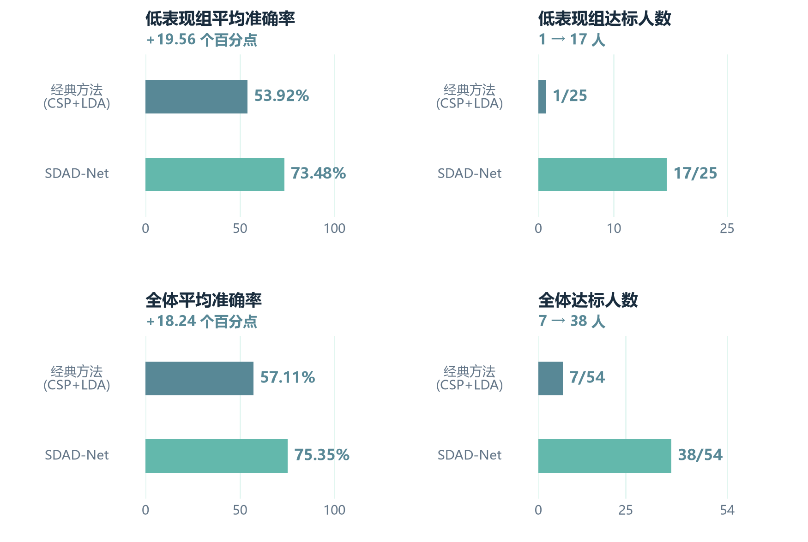
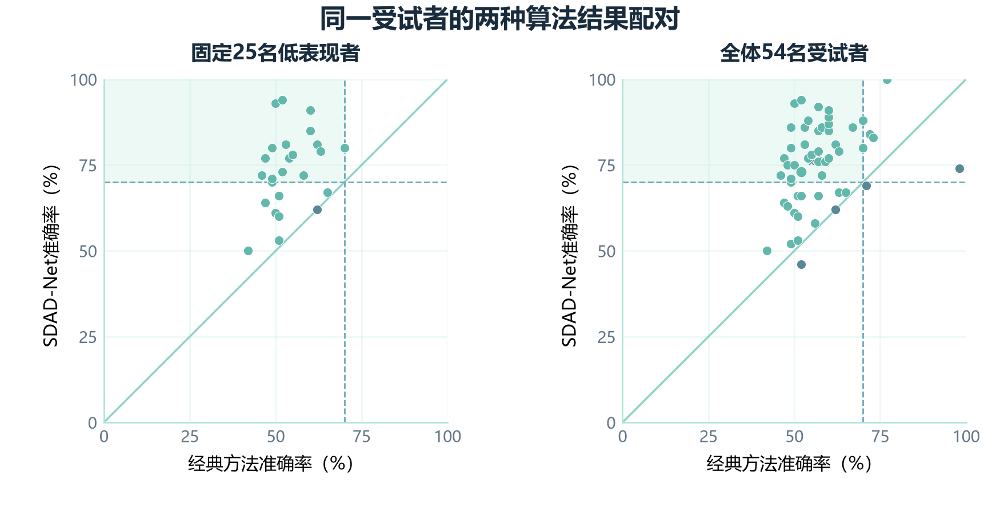

# SDAD-Net 最佳展示运行 43 / 43

本目录保存模型3的已完成实验记录和模型配套资料。选择预训练种子43、后期种子43的一次运行，作为三次运行中的最佳展示结果；它不是三次平均，也不代表每个受试者的最佳结果。

## 结果

固定session2测试；低表现组为训练阶段定义的25人，达标阈值为准确率≥70%。

| 指标 | 匹配无对抗对照 | SDAD-Net 后期高低组DANN |
|---|---:|---:|
| 全体平均准确率 | 74.17% | 75.35% |
| 全体达标人数 | 35/54 | 38/54 |
| 固定低组平均准确率 | 71.76% | 73.48% |
| 固定低组达标人数 | 13/25 | 17/25 |

两分支从相同的预训练43最后检查点（107轮）出发，继续训练10轮。验证集分别选中control第8轮、group第5轮。基础模型保留蒸馏，group分支通过外部域辅助头实施后期对抗；配置中的基础模型`dann: false`不代表外部后期域头未启用。

## 文件导航

| 路径 | 内容 |
|---|---|
| `training/group/` | 最佳展示方法的配置、逐轮历史、初始与选中验证指标、预处理参数 |
| `training/control/` | 与展示方法匹配的无对抗对照记录 |
| `test/comparison.json` | 仅保留control与group的测试汇总及配对统计 |
| `test/comparison_original.json` | 原始完整汇总，包含同批subject身份对抗分支，保留以核对来源 |
| `test/paired_subjects.csv` | 54名受试者的配对准确率、差值及达标情况 |
| `test/group/`、`test/control/` | 每名受试者的100试次标签与两类预测概率NPZ，以及逐人指标JSON |
| `logs/` | 未改写的原始训练与测试日志；其中含同批subject分支输出 |
| `figures/` | 报告中的完整算法效果对比图、逐人配对散点图，PNG与PDF版本 |
| `SHA256SUMS.txt` | 本目录文件的SHA-256校验清单 |

## 评估口径

- session1/train训练，session1/test验证，session2/test测试；验证选模，测试不参与选轮。
- 联合CSP+LDA为图中的固定经典参考：全体57.11%、7/54达标；固定低组53.92%、1/25达标。完整算法相对它的收益包含融合表征、蒸馏等因素，不能全部归因于DANN。
- 此目录只归档一次最佳展示运行。session2已经在研究中多次查看，结果属于探索性证据；不将其解释为跨种子稳定提升或临床疗效。
- 这是模型3跨会话协议；模型2采用的受试者留出协议不同，统计不能直接混算。

## 权重与数据范围

本次上传不包含`.pt`、`.pth`模型权重、优化器状态、训练缓存或原始EEG。NPZ中仅含`labels`和`probabilities`，不是原始脑电信号。`preprocessing.joblib`是预处理参数，须与后续补充的匹配权重一起使用；仅凭本目录不能直接运行模型推理。

原始实验目录：`late_subject_domain_43_001`；测试目录：`late_subject_domain_43_001_test`。本次为资料归档，未重新训练或改写算法。
